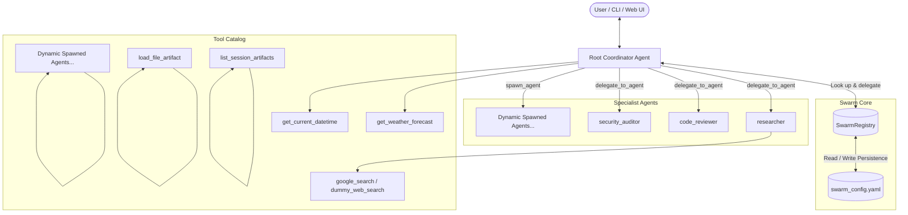

# ADK Agent Swarm

[](https://www.python.org/)
[](https://github.com/google/adk)
[](LICENSE)
[](test_swarm.py)

A flexible, production-ready **Agent Swarm Architecture** built upon the **Google Agent Development Kit (ADK)**.

It provides declarative agent definitions via YAML, dynamic runtime agent generation with automatic on-disk persistence, session-scoped versioned artifacts, and real-time environment intelligence (live web search, weather, and timezone timestamps).

---

## Architecture Overview



---

## Key Features

- **Declarative YAML Configuration (`swarm_config.yaml`)**: Define your swarm name, default model, coordinator agent, and specialist workforce cleanly in YAML.
- **Dynamic Runtime Agent Spawning**: When the coordinator encounters a problem requiring a missing specialty, it invokes `spawn_agent` to construct and equip a new specialist agent on the fly.
- **Automatic Disk Persistence**: Spawned agents are automatically appended back to `swarm_config.yaml` (`persist=True` by default) so that dynamic agents survive application restarts.
- **Dual Delegation Options**:
  - Direct execution via `delegate_to_agent(agent_name, task)` runner dispatch.
  - Native ADK sub-agent transfer hierarchies.
- **Session-Scoped Versioned Artifacts**: Full set of tools for saving, loading, and listing session deliverables (`save_file_as_artifact`, `load_file_artifact`, `list_session_artifacts`) across conversation rounds.
- **Live Real-World Tools**: Equips agents with real-time web search (`google_search`), live weather (`get_weather_forecast`), and accurate datetime/timezone data (`get_current_datetime`).
- **ADK Native Tooling**: Out-of-the-box support for `adk run` (terminal REPL), `adk web` (browser visual playground), and `adk api_server`.

---

## Project Structure

```
adk-swarm/
├── swarm/
│   ├── __init__.py            # Exports 'app' and 'root_agent' for ADK CLI discovery
│   └── agent.py               # Application factory wiring registry to ADK App
├── swarm_registry.py          # SwarmRegistry: manages tools, parses YAML, spawns agents
├── swarm_tools.py             # Tool implementations: spawn, delegate, artifacts, weather, datetime
├── swarm_config.yaml          # Declarative swarm configuration and persisted agents
├── main.py                    # Standalone demo verifying build, dynamic spawn & persistence
├── test_swarm.py              # Automated test suite (pytest + pytest-asyncio)
└── pyproject.toml             # Project metadata, dependencies, and build config
```

---

## Quick Start

### 1. Prerequisites

- Python `>= 3.13`
- [uv](https://docs.astral.sh/uv/) package manager (recommended) or `pip`

### 2. Installation

Clone the repository and install dependencies:

```bash
git clone https://github.com/your-org/adk-swarm.git
cd adk-swarm
uv sync
```

### 3. Configure Gemini API Key

Obtain an API key from [Google AI Studio](https://aistudio.google.com/):

```bash
# macOS / Linux
export GEMINI_API_KEY="your-gemini-api-key"

# Windows PowerShell
$env:GEMINI_API_KEY="your-gemini-api-key"

# Windows Command Prompt
set GEMINI_API_KEY=your-gemini-api-key
```

### 4. Running the Swarm

#### Option A: Visual Web Playground (ADK DevUI)

Run the built-in ADK Web interface:

```bash
uv run adk web . --port 8000
```

Open [http://localhost:8000](http://localhost:8000) in your browser to interact with the swarm.

#### Option B: Interactive Terminal REPL

Run the interactive CLI session directly in your terminal:

```bash
uv run adk run swarm
```

#### Option C: Standalone Python Demo

Run the verification script that initializes the swarm, spawns a new agent with persistence, and reloads from disk:

```bash
uv run python main.py
```

---

## Tool Catalog Reference

All tools are modular and can be assigned to any agent in `swarm_config.yaml` or during runtime spawning.

| Category | Tool | Parameters | Description |
| --- | --- | --- | --- |
| **Swarm Orchestration** | `spawn_agent` | `name`, `role`, `instruction`, `tool_names`, `persist=True` | Creates a new specialist agent dynamically and persists it to YAML. |
| | `list_swarm_agents` | _(none)_ | Returns the roster of all registered agents and their assigned tools. |
| | `delegate_to_agent` | `agent_name`, `task` | Dispatches a specific task directly to a named agent and returns the output. |
| **Artifact Management** | `save_file_as_artifact` | `filename`, `content`, `mime_type` | Saves text, markdown, or code as a versioned session artifact. |
| | `load_file_artifact` | `filename`, `version=None` | Loads a saved artifact from the current session (latest or specific version). |
| | `list_session_artifacts` | _(none)_ | Lists all artifact files created during the active session. |
| **Real-time Context** | `google_search` | `query` | Built-in Google Search tool from Google ADK. |
| | `get_weather_forecast` | `location="London"` | Real-time weather conditions and 3-day forecast via wttr.in. |
| | `get_current_datetime` | `timezone="UTC"` | Current time, date, weekday, and ISO timestamp for any IANA timezone. |

---

## Configuration Reference (`swarm_config.yaml`)

Agents and settings are declared hierarchically:

```yaml
version: '1.0'
swarm:
  name: adk_agent_swarm
  default_model: gemini-2.5-flash
  shared_state:
    task_board: []
    active_workers: []

agents:
  - name: coordinator
    role: Swarm Orchestrator and Dispatcher
    is_root: true                       # Marks the entry-point agent for the App
    model: gemini-2.5-flash
    instruction: |
      You are the Coordinator of an ADK Agent Swarm...
    tools:
      - spawn_agent
      - list_swarm_agents
      - delegate_to_agent
      - save_file_as_artifact
      - load_file_artifact
      - list_session_artifacts
      - get_weather_forecast
      - get_current_datetime

  - name: researcher
    role: General Technical Researcher
    model: gemini-2.5-flash
    instruction: |
      You are an expert researcher...
    tools:
      - get_current_datetime
      - get_weather_forecast
      - save_file_as_artifact
      - load_file_artifact
      - list_session_artifacts
    disallow_transfer_to_parent: false
```

### Agent Fields

- `name` _(string, required)_: Unique identifier for the agent (e.g. `coordinator`, `researcher`).
- `role` _(string, required)_: Brief summary of purpose and domain capability.
- `instruction` _(string, required)_: System instructions governing behavior and expectations.
- `is_root` _(bool, optional)_: Set to `true` for the primary dispatcher agent.
- `model` _(string, optional)_: Gemini model name (defaults to `swarm.default_model`).
- `tools` _(list of strings, optional)_: Names of tools assigned from the registry tool catalog.
- `disallow_transfer_to_parent` _(bool, optional)_: ADK transfer constraint flag.

---

## Example Usage Scenarios

### 1. Spawning a New Specialist at Runtime

In the web UI or CLI, ask the coordinator:
> _"We need a database architect to design our PostgreSQL schema for a multi-tenant SaaS app. Please spawn a specialist named db_architect."_

The coordinator calls `spawn_agent`:

```json
{
  "name": "db_architect",
  "role": "PostgreSQL Database Architect",
  "instruction": "You design optimized, normalized, and performant SQL database schemas...",
  "tool_names": ["save_file_as_artifact", "load_file_artifact", "list_session_artifacts"],
  "persist": true
}
```

The agent is instantly usable in the session and permanently added to `swarm_config.yaml`.

### 2. Delegating and Producing Artifacts
>
> _"Coordinator, please have the researcher analyze quantum computing breakthroughs in 2026, and save the report as 'quantum_2026.md'."_

The coordinator calls:

1. `delegate_to_agent(agent_name="researcher", task="Research 2026 quantum computing breakthroughs...")`
2. Researcher analyzes the breakthroughs and saves the findings via `save_file_as_artifact(filename="quantum_2026.md", content="...")`.
3. The result is stored as a session artifact and available for downstream specialist review.

---

## Running Automated Tests

Run the full test suite using `pytest`:

```bash
uv run pytest -v
```

This validates:

- YAML parsing and agent hierarchy configuration.
- Runtime dynamic agent spawning with permanent disk persistence.
- Ephemeral agent spawning (`persist=False`).
- Execution of `delegate_to_agent` via runners.
- Versioned artifact creation and retrieval.

---

## License

This project is licensed under the MIT License.
