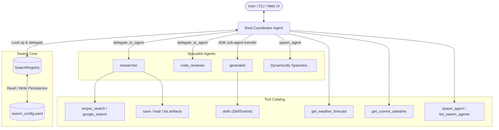
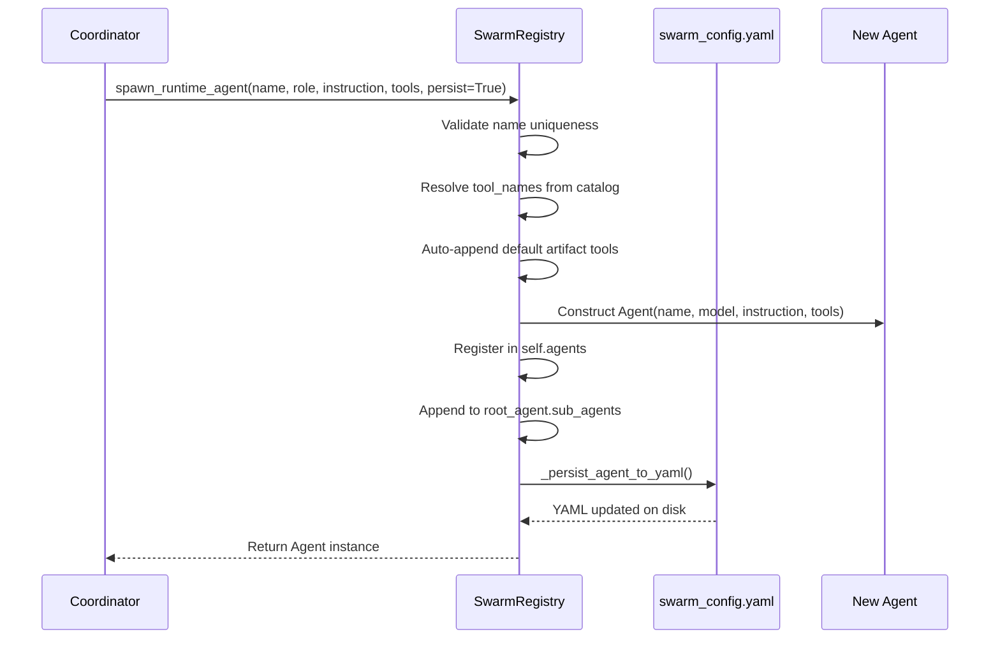

# Building a Self-Organizing Agent Swarm with Google ADK

## How to Build a Declarative, Self-Expanding Multi-Agent System That Spawns Its Own Specialists at Runtime

---

> **TL;DR** — We built an open-source Agent Swarm framework on top of Google's Agent Development Kit (ADK) that lets you define an army of AI specialists in a single YAML file, then watch the coordinator spawn brand-new agents on the fly when it encounters a task no existing specialist can handle. Spawned agents are automatically persisted to disk, survive restarts, and immediately join the swarm's hierarchy. The system ships with live web search, weather intelligence, timezone-aware timestamps, versioned session artifacts, and native ADK Skills support — all wirable from configuration.

---

## Table of Contents

- [Building a Self-Organizing Agent Swarm with Google ADK](#building-a-self-organizing-agent-swarm-with-google-adk)
  - [How to Build a Declarative, Self-Expanding Multi-Agent System That Spawns Its Own Specialists at Runtime](#how-to-build-a-declarative-self-expanding-multi-agent-system-that-spawns-its-own-specialists-at-runtime)
  - [Table of Contents](#table-of-contents)
  - [The Problem: Why One Agent Isn't Enough](#the-problem-why-one-agent-isnt-enough)
  - [Architecture at a Glance](#architecture-at-a-glance)
  - [Core Design Decisions](#core-design-decisions)
    - [1. YAML-First, Code-Second](#1-yaml-first-code-second)
    - [2. Shared Tool Catalog with Late Binding](#2-shared-tool-catalog-with-late-binding)
    - [3. The Coordinator is an Agent, Not a Router](#3-the-coordinator-is-an-agent-not-a-router)
    - [4. Persistence by Default](#4-persistence-by-default)
  - [The Configuration Layer: `swarm_config.yaml`](#the-configuration-layer-swarm_configyaml)
  - [The Registry: Brain of the Swarm](#the-registry-brain-of-the-swarm)
    - [Tool Catalog Management](#tool-catalog-management)
    - [Config Loading \& Agent Construction](#config-loading--agent-construction)
    - [YAML Persistence](#yaml-persistence)
  - [Tool System Deep Dive](#tool-system-deep-dive)
    - [Factory Pattern for Registry-Bound Tools](#factory-pattern-for-registry-bound-tools)
    - [Real-Time Intelligence Tools](#real-time-intelligence-tools)
  - [Dynamic Agent Spawning \& Persistence](#dynamic-agent-spawning--persistence)
  - [Delegation Patterns: Two Ways to Route Work](#delegation-patterns-two-ways-to-route-work)
    - [Pattern 1: `delegate_to_agent` (Programmatic Dispatch)](#pattern-1-delegate_to_agent-programmatic-dispatch)
    - [Pattern 2: ADK Native Sub-Agent Transfer](#pattern-2-adk-native-sub-agent-transfer)
  - [Session Artifacts: Versioned Deliverables](#session-artifacts-versioned-deliverables)
  - [Agent Skills: Progressive Capability Discovery](#agent-skills-progressive-capability-discovery)
  - [ADK Integration: CLI, Web UI \& API Server](#adk-integration-cli-web-ui--api-server)
  - [Testing Strategy](#testing-strategy)
    - [Configuration \& Hierarchy Tests](#configuration--hierarchy-tests)
    - [Persistence Round-Trip Tests](#persistence-round-trip-tests)
    - [Ephemeral Agent Tests](#ephemeral-agent-tests)
    - [Artifact Integration Tests](#artifact-integration-tests)
    - [External API Mocking](#external-api-mocking)
  - [Putting It All Together: A Real Session Walkthrough](#putting-it-all-together-a-real-session-walkthrough)
  - [Lessons Learned \& Future Directions](#lessons-learned--future-directions)
    - [What Worked Well](#what-worked-well)
    - [Current Limitations](#current-limitations)
    - [Future Directions](#future-directions)
  - [Technical Stack Summary](#technical-stack-summary)
  - [Getting Started](#getting-started)

---

## The Problem: Why One Agent Isn't Enough

Modern LLM-based agents excel at focused tasks — summarization, code review, creative writing — but struggle when you need them to juggle fundamentally different domains in a single conversation. A monolithic agent with a giant system prompt quickly suffers from instruction dilution: the more responsibilities you pack into one prompt, the worse each individual capability performs.

The classic solution is **multi-agent orchestration**: a coordinator that understands the high-level goal and dispatches sub-tasks to specialist agents, each with a sharp, focused instruction set. But most multi-agent frameworks require you to hard-code every specialist up front. What happens when the coordinator encounters a task type nobody anticipated?

That's the gap **ADK Swarm** fills. The coordinator can **spawn new specialist agents at runtime**, wire them with tools from a shared catalog, and — critically — **persist them back to the configuration file** so they're available in every future session. The swarm doesn't just execute; it *evolves*.

---

## Architecture at a Glance



The architecture separates three concerns cleanly:

| Layer | Responsibility | Implementation |
| ------- | --------------- | ---------------- |
| **Configuration** | Declarative agent definitions | `swarm_config.yaml` (YAML) |
| **Registry** | Agent lifecycle, tool binding, persistence | `SwarmRegistry` class |
| **Tools** | Capabilities agents can invoke | `swarm_tools.py` + external APIs |

---

## Core Design Decisions

### 1. YAML-First, Code-Second

Agents are defined declaratively in YAML — name, role, instruction, model, and tool assignments. The Python code never hard-codes agent definitions. This means:

- **Non-engineers** can add agents by editing a YAML file.
- **Version control** diffs show exactly what changed in the swarm composition.
- **Dynamic agents** persisted at runtime produce YAML entries identical to hand-written ones.

### 2. Shared Tool Catalog with Late Binding

Tools are registered by name in a central catalog *before* agents are loaded. When an agent definition references `tools: [serper_search, save_file_as_artifact]`, the registry resolves those strings to actual Python callables at load time. This decouples tool implementation from agent definition and allows the same tool to be shared across many agents.

### 3. The Coordinator is an Agent, Not a Router

The coordinator is itself a full LLM agent (not a programmatic router). It has its own system prompt, can reason about which specialist to invoke, and can decide to spawn a new one if none fits. This makes the routing decision flexible and context-aware rather than keyword-matched.

### 4. Persistence by Default

When `spawn_agent` is called with `persist=True` (the default), the new agent is written back to `swarm_config.yaml`. This is a deliberate choice: the system learns from its own operational needs. Ephemeral agents (`persist=False`) are supported for one-off, throwaway tasks.

---

## The Configuration Layer: `swarm_config.yaml`

The configuration file is the single source of truth for the swarm's composition:

```yaml
version: '1.0'
swarm:
  name: adk_agent_swarm
  default_model: gemini-2.5-flash
  shared_state:
    task_board: []
    active_workers: []

agents:
  - name: coordinator
    role: Swarm Orchestrator and Dispatcher
    is_root: true
    model: gemini-2.5-flash
    instruction: |
      You are the Coordinator of an ADK Agent Swarm.
      You coordinate tasks across available specialists.
      If a required specialist does not exist, use `spawn_agent`
      (with persist=True) to create one permanently.
      ...
    tools:
      - spawn_agent
      - list_swarm_agents
      - delegate_to_agent
      - save_file_as_artifact
      - get_weather_forecast
      - get_current_datetime

  - name: researcher
    role: General Technical Researcher
    model: gemini-2.5-flash
    instruction: |
      You are an expert researcher. Use `serper_search`
      to find accurate, up-to-date web information...
    tools:
      - skills
      - serper_search
      - save_file_as_artifact
    disallow_transfer_to_parent: false
```

**Key schema fields:**

| Field | Type | Purpose |
| ------- | ------ | --------- |
| `name` | `string` | Unique agent identifier (used in spawn/delegate calls) |
| `role` | `string` | Maps to ADK `Agent.description` — visible to the coordinator for routing |
| `is_root` | `bool` | Marks the entry-point agent; all others become its `sub_agents` |
| `instruction` | `string` | System prompt defining agent behavior |
| `model` | `string` | Gemini model override (falls back to `swarm.default_model`) |
| `tools` | `list[str]` | Tool names resolved from the shared catalog |
| `disallow_transfer_to_parent` | `bool` | ADK transfer constraint — prevents agents from handing control back up |

---

## The Registry: Brain of the Swarm

The `SwarmRegistry` class ([swarm_registry.py](swarm_registry.py)) is the central nervous system. Its responsibilities:

### Tool Catalog Management

```python
class SwarmRegistry:
    def __init__(self, default_model: str = "gemini-2.5-flash"):
        self.agents: dict[str, Agent] = {}
        self.tool_catalog: dict[str, Any] = {}
        self.root_agent_name: str | None = None
        self.config_path: str | None = None

    def register_tool(self, name: str, tool_fn_or_obj: Any) -> None:
        self.tool_catalog[name] = tool_fn_or_obj
```

Tools are registered as named entries before config loading. This includes plain functions (`serper_search`), ADK built-in tools (`google_search`), and composite toolsets (`SkillToolset`).

### Config Loading & Agent Construction

The `load_from_config` method parses YAML, constructs `google.adk.agents.Agent` instances, resolves tool references, and wires the sub-agent hierarchy:

```python
def load_from_config(self, config_path: str) -> Agent:
    with open(self.config_path, "r") as f:
        data = yaml.safe_load(f)

    for item in data.get("agents", []):
        resolved_tools = [
            self.tool_catalog[t]
            for t in item.get("tools", [])
            if t in self.tool_catalog
        ]
        agent = Agent(
            name=item["name"],
            model=item.get("model", self.default_model),
            instruction=item.get("instruction", "").strip(),
            description=item.get("role"),
            tools=resolved_tools,
        )
        self.agents[item["name"]] = agent

    # Wire non-root agents as sub_agents of root
    if root_agent:
        root_agent.sub_agents = [
            a for name, a in self.agents.items()
            if name != self.root_agent_name
        ]
```

This automatic sub-agent wiring means every specialist is immediately available to the coordinator for ADK's native transfer mechanism.

### YAML Persistence

When a runtime-spawned agent needs to survive restarts, the registry appends its definition to the YAML file:

```python
def _persist_agent_to_yaml(self, name, role, instruction, tool_names, model):
    with open(self.config_path, "r") as f:
        data = yaml.safe_load(f)

    # Deduplication guard
    for existing in data["agents"]:
        if existing.get("name") == name:
            return

    data["agents"].append({
        "name": name, "role": role, "model": model,
        "instruction": instruction, "tools": tool_names,
    })

    with open(self.config_path, "w") as f:
        yaml.dump(data, f, default_flow_style=False, sort_keys=False)
```

The deduplication guard ensures idempotency — spawning the same agent name twice won't create duplicate YAML entries.

---

## Tool System Deep Dive

All tools live in [swarm_tools.py](swarm_tools.py) and follow a consistent pattern: they accept typed parameters, return structured dictionaries with a `status` field, and gracefully handle errors.

### Factory Pattern for Registry-Bound Tools

Tools that need access to the registry (spawn, delegate, list) are created via a factory function that closes over the registry instance:

```python
def create_swarm_tools(registry: SwarmRegistry) -> list[Callable]:
    def spawn_agent(name, role, instruction, tool_names=None,
                    persist=True, tool_context=None):
        agent = registry.spawn_runtime_agent(...)
        return {"status": "success", "agent": {...}}

    def list_swarm_agents(tool_context=None):
        return {"status": "success", "agents": registry.list_agents()}

    async def delegate_to_agent(agent_name, task_prompt, tool_context=None):
        agent = registry.get_agent(agent_name)
        runner = InMemoryRunner(agent=agent, ...)
        # ... execute and collect response
        return {"status": "success", "output": output_text}

    return [spawn_agent, list_swarm_agents, delegate_to_agent, ...]
```

This closure-based factory avoids globals and makes testing straightforward — inject a mock registry and get mock tools.

### Real-Time Intelligence Tools

The swarm ships with three environment-awareness tools:

**`serper_search`** — Production web search via the Serper API (google.serper.dev). Returns organic results, Knowledge Graph entries, and "People Also Ask" data:

```python
def serper_search(query: str, num_results: int = 5) -> dict:
    api_key = os.getenv("SERPER_API_KEY")
    payload = json.dumps({"q": query, "num": num_results})
    # POST to google.serper.dev/search
    # Returns: organic[], knowledge_graph, people_also_ask[]
```

**`get_weather_forecast`** — Live weather via wttr.in with current conditions and a 3-day forecast:

```python
def get_weather_forecast(location: str = "London") -> dict:
    url = f"https://wttr.in/{encoded_loc}?format=j1"
    # Returns: temperature, humidity, wind, 3-day forecast
```

**`get_current_datetime`** — Timezone-aware timestamps using Python's `zoneinfo` module with graceful UTC fallback for invalid timezones:

```python
def get_current_datetime(timezone: str = "UTC") -> dict:
    tz = zoneinfo.ZoneInfo(timezone)
    now = datetime.now(tz)
    return {"datetime_iso": now.isoformat(), "date": ..., "weekday": ...}
```

---

## Dynamic Agent Spawning & Persistence

This is the system's signature capability. When the coordinator encounters a task requiring a specialty not present in the swarm, it calls `spawn_agent`:

```
User: "We need a database architect to design our PostgreSQL schema."
Coordinator thinks: No db_architect in the roster. I'll spawn one.
Coordinator calls: spawn_agent(
    name="db_architect",
    role="PostgreSQL Database Architect",
    instruction="You design optimized, normalized database schemas...",
    tool_names=["save_file_as_artifact"],
    persist=True
)
```

What happens under the hood:



The `spawn_runtime_agent` method also **auto-equips artifact tools** (`save_file_as_artifact`, `load_file_artifact`, `list_session_artifacts`) on every new agent, ensuring all specialists can produce deliverables without explicit configuration:

```python
DEFAULT_ARTIFACT_TOOLS = [
    "save_file_as_artifact",
    "load_file_artifact",
    "list_session_artifacts",
]

def spawn_runtime_agent(self, name, role, instruction, tool_names=None, persist=True):
    final_tools = list(tool_names) if tool_names else []
    for default_tool in DEFAULT_ARTIFACT_TOOLS:
        if default_tool in self.tool_catalog and default_tool not in final_tools:
            final_tools.append(default_tool)
    # ... construct and register
```

---

## Delegation Patterns: Two Ways to Route Work

ADK Swarm supports two distinct delegation mechanisms:

### Pattern 1: `delegate_to_agent` (Programmatic Dispatch)

The coordinator explicitly calls the `delegate_to_agent` tool with a target agent name and a task prompt. Under the hood, this spins up an `InMemoryRunner`, creates a session, sends the prompt, and collects the streamed response:

```python
async def delegate_to_agent(agent_name, task_prompt, tool_context=None):
    agent = registry.get_agent(agent_name)
    runner = InMemoryRunner(agent=agent, app_name=f"swarm_task_{agent_name}")

    await runner.session_service.create_session(
        app_name=f"swarm_task_{agent_name}",
        user_id="swarm_coordinator",
        session_id=f"session_{agent_name}",
    )

    async for event in runner.run_async(
        user_id="swarm_coordinator",
        session_id=f"session_{agent_name}",
        new_message=Content(role="user", parts=[Part(text=task_prompt)]),
    ):
        if event.content and event.content.parts:
            for part in event.content.parts:
                if part.text:
                    response_chunks.append(part.text)

    return {"status": "success", "output": "".join(response_chunks)}
```

**When to use**: When the coordinator needs to process the specialist's output before returning to the user (filtering, aggregation, multi-step workflows).

### Pattern 2: ADK Native Sub-Agent Transfer

Because all specialist agents are wired as `sub_agents` of the coordinator, ADK's built-in transfer mechanism is also available. The coordinator can simply mention the agent and ADK handles the routing internally.

**When to use**: For simple pass-through where the user interacts directly with the specialist.

---

## Session Artifacts: Versioned Deliverables

Every agent in the swarm can produce **versioned artifacts** — files stored within the ADK session that survive across conversation turns:

```python
async def save_file_as_artifact(filename, content, mime_type="text/plain",
                                 tool_context=None):
    part = genai_types.Part(
        inline_data=genai_types.Blob(
            mime_type=mime_type,
            data=content.encode("utf-8"),
        )
    )
    version = await tool_context.save_artifact(filename=filename, artifact=part)
    return {"status": "success", "filename": filename, "version": version}
```

The artifact system supports:

| Operation | Tool | Description |
| ----------- | ------ | ------------- |
| **Create/Update** | `save_file_as_artifact` | Saves content with automatic version numbering |
| **Read** | `load_file_artifact` | Retrieves by filename, optionally at a specific version |
| **Index** | `list_session_artifacts` | Lists all artifact filenames in the session |

Artifacts are stored using ADK's `InMemoryArtifactService` (or any custom `ArtifactService` implementation). Each save increments the version counter, creating a full history of revisions.

**Example workflow**: A coordinator delegates a research task. The researcher produces `quantum_2026.md` as an artifact. The coordinator then delegates an editing task to a code reviewer, who loads the artifact, reviews it, and saves `quantum_2026_reviewed.md`.

---

## Agent Skills: Progressive Capability Discovery

ADK Swarm integrates Google ADK's native **Skills** system for progressive capability disclosure. Skills are structured packages stored in a `skills/` directory:

```
skills/
└── market-research/
    └── SKILL.md
```

The registry discovers and loads skills at startup:

```python
def load_skills_toolset(self, skills_dir="skills") -> SkillToolset | None:
    p = Path(skills_dir).resolve()
    has_skills = any(
        child.is_dir() and (child / "SKILL.md").exists()
        for child in p.iterdir()
    )
    if has_skills:
        skills = load_skills_from_dir(p)
        toolset = SkillToolset(skills=skills)
        self.register_tool("skills", toolset)
        return toolset
```

Once loaded, agents with the `skills` tool can:

- **`list_skills`** — Browse available skills by name and description.
- **`load_skill`** — Read the full skill instructions and apply them to the current task.

This creates a "just-in-time knowledge" pattern where agents don't need to have every capability pre-loaded — they discover and apply specialized workflows on demand.

---

## ADK Integration: CLI, Web UI & API Server

The swarm integrates seamlessly with every ADK runtime surface through the [swarm/](swarm/) package:

```python
# swarm/__init__.py
from .agent import app, root_agent

# swarm/agent.py
def _build() -> App:
    registry = SwarmRegistry()
    registry.register_tool("serper_search", serper_search)
    registry.register_tool("get_weather_forecast", get_weather_forecast)
    registry.register_tool("get_current_datetime", get_current_datetime)
    registry.load_skills_toolset(project_root / "skills")

    for fn in create_swarm_tools(registry):
        registry.register_tool(fn.__name__, fn)

    registry.load_from_config(str(config))
    return App(name="swarm", root_agent=registry.agents[registry.root_agent_name])

app = _build()
root_agent = app.root_agent
```

By exporting `app` and `root_agent` at the package level, the ADK CLI discovers the swarm automatically:

| Command | Surface | Use Case |
| --------- | --------- | ---------- |
| `uv run adk web . --port 8000` | Browser DevUI | Visual playground with conversation history |
| `uv run adk run swarm` | Terminal REPL | Interactive CLI session |
| `uv run adk api_server` | HTTP API | Programmatic integration |
| `uv run python main.py` | Standalone | Build verification & demo |

---

## Testing Strategy

The test suite ([test_swarm.py](test_swarm.py)) validates the system at multiple levels:

### Configuration & Hierarchy Tests

```python
def test_load_from_config(sample_config):
    root_agent = registry.load_from_config(sample_config)
    assert root_agent.name == "coordinator"
    assert len(root_agent.sub_agents) == 1
    assert root_agent.sub_agents[0].name == "researcher"
```

### Persistence Round-Trip Tests

Verifies that dynamically spawned agents survive a full reload cycle:

```python
def test_spawn_runtime_agent_permanent_persistence(sample_config):
    registry.spawn_runtime_agent(
        name="crypto_analyst", role="Crypto Market Analyst",
        instruction="Analyze cryptographic tokens.", persist=True
    )

    # Reload from YAML
    fresh_registry = SwarmRegistry()
    fresh_registry.load_from_config(sample_config)
    assert "crypto_analyst" in fresh_registry.agents
```

### Ephemeral Agent Tests

Confirms that `persist=False` agents don't pollute the config:

```python
def test_spawn_runtime_agent_ephemeral(sample_config):
    registry.spawn_runtime_agent(name="ephemeral_agent", persist=False)
    with open(sample_config) as f:
        data = yaml.safe_load(f)
    assert "ephemeral_agent" not in [a["name"] for a in data["agents"]]
```

### Artifact Integration Tests

Full async tests for the save → list → load artifact lifecycle using `InMemoryArtifactService` and mocked `ToolContext`:

```python
@pytest.mark.asyncio
async def test_artifact_tools():
    save_res = await save_tool(filename="report.txt", content="Hello", tool_context=ctx)
    assert save_res["status"] == "success"

    load_res = await load_tool(filename="report.txt", tool_context=ctx)
    assert load_res["content"] == "Hello"
```

### External API Mocking

The Serper search tool is tested with both error cases (missing API key, empty query) and mocked success responses:

```python
def test_serper_search_mocked_success(monkeypatch):
    monkeypatch.setenv("SERPER_API_KEY", "test_key")
    monkeypatch.setattr("urllib.request.urlopen", mock_urlopen)
    res = serper_search("Google ADK", num_results=3)
    assert res["organic"][0]["title"] == "Google ADK Docs"
```

Run the full suite:

```bash
uv run pytest -v
```

---

## Putting It All Together: A Real Session Walkthrough

Here's what a complete interaction looks like:

```
User: "Create a children's ebook about a robot learning to paint. 
       I need 5 short stories, each illustrated, edited, and formatted."

Coordinator:
  1. Checks roster → sees story_writer, illustrator, editor, ebook_formatter
  2. Delegates to story_writer: "Write 5 short stories about a robot painter..."
  3. story_writer produces story_1.txt through story_5.txt as artifacts
  4. Delegates to editor: "Review and polish these stories..."
  5. editor loads each artifact, edits, saves story_1_edited.txt through story_5_edited.txt
  6. Delegates to illustrator: "Create illustration descriptions for each story..."
  7. illustrator saves illustration_suggestions.md as artifact
  8. Delegates to ebook_formatter: "Compile the final ebook content outline..."
  9. ebook_formatter saves ebook_content_outline.md as artifact
  10. Coordinator summarizes the full pipeline to the user
```

Every artifact is versioned, every agent interaction is tracked, and the entire workflow is orchestrated by a single natural-language request.

---

## Lessons Learned & Future Directions

### What Worked Well

- **YAML-first design** dramatically lowered the barrier to swarm customization. Adding a new specialist is a 10-line YAML block.
- **Auto-persistence** of spawned agents creates an organic growth pattern — the swarm adapts to workload over time.
- **Closure-based tool factories** made testing painless by decoupling tool logic from framework internals.
- **ADK's native sub-agent wiring** eliminated the need for a custom routing layer.

### Current Limitations

- **Single-file persistence** — `swarm_config.yaml` can grow large if agents accumulate. A directory-based layout (one YAML per agent) would scale better.
- **No agent retirement** — Once persisted, there's no mechanism to deprecate or remove agents. A TTL or usage-based pruning system would help.
- **Synchronous YAML writes** — Under concurrent spawning, the YAML read-modify-write cycle could race. A locking mechanism or database-backed registry would be safer for production.

### Future Directions

1. **Inter-agent messaging** — Allow agents to communicate directly with each other without routing through the coordinator.
2. **Persistent session state** — Move from `InMemoryRunner` to database-backed sessions for production deployments.
3. **Agent capability negotiation** — Let the coordinator query agents about their capabilities before delegation, rather than relying solely on role descriptions.
4. **Tool marketplace** — A registry of community-contributed tools that agents can install on demand.
5. **Observability dashboard** — Trace delegation chains, artifact production, and agent utilization metrics.

---

## Technical Stack Summary

| Component | Technology | Version |
| ----------- | ----------- | --------- |
| Runtime | Python | ≥ 3.13 |
| Agent Framework | Google ADK | ≥ 2.15.0 |
| LLM | Gemini 2.5 Flash | — |
| Configuration | YAML (PyYAML) | ≥ 6.0.4 |
| Package Manager | uv | Latest |
| Validation | Pydantic | ≥ 2.14.4 |
| Testing | pytest + pytest-asyncio | ≥ 9.2.0 |
| Environment | python-dotenv | ≥ 1.0.0 |
| Web Search | Serper API | — |
| Weather | wttr.in | — |

---

## Getting Started

```bash
# Clone and install
git clone https://github.com/your-org/adk-swarm.git
cd adk-swarm
uv sync

# Configure API keys
cp .env.example .env
# Edit .env with your GEMINI_API_KEY and SERPER_API_KEY

# Launch the visual playground
uv run adk web . --port 8000

# Or run interactively in the terminal
uv run adk run swarm

# Run tests
uv run pytest -v
```

---

*ADK Swarm is open source under the MIT License. Built with [Google Agent Development Kit (ADK)](https://github.com/google/adk) and [Gemini](https://ai.google.dev/).*
